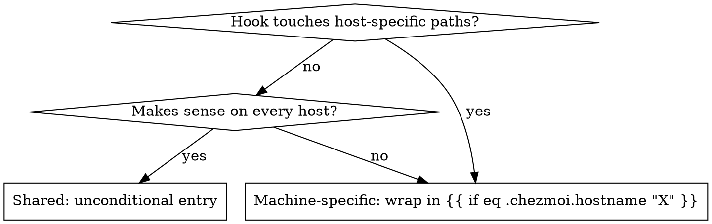

# Writing Fleet Hooks

Claude Code hooks on this fleet are managed through chezmoi. Scripts live in the shared source so every machine has them on disk; `modify_private_settings.json.tmpl` (a chezmoi `modify_` script — it force-owns settings.json's `hooks`+`permissions` keys and leaves runtime keys to Claude Code) registers each one conditionally on hostname. Follow this when adding or changing a hook.

**Bash-guard special case:** the fleet's per-Bash-call guards (blast-radius / AUR review / npm review) are consolidated in the single `bash-guards.sh` dispatcher (2026-07-01). A new guard that matches on Bash commands should be added as another matcher section inside that dispatcher, NOT as a new registration — every separate per-Bash registration costs an extra process spawn + jq parse on every shell command.

## Where things live

| Path | Role |
|---|---|
| `~/.claude/hooks/<name>.sh` | Working copy on each host (what Claude Code runs) |
| `~/.local/share/chezmoi/dot_claude/hooks/executable_<name>.sh` | Chezmoi source (tracked in git) |
| `~/.local/share/chezmoi/dot_claude/modify_private_settings.json.tmpl` | Hostname-templated hook registry (modify_ script; owns `hooks`+`permissions`) |
| `~/.claude/settings.local.json` | Per-host permissions overrides (not chezmoi-tracked) |

## Hook script contract

- **Input:** JSON on stdin. Relevant fields per event:
  - `PreToolUse`/`PostToolUse`: `tool_name`, `tool_input.file_path` (Edit/Write/MultiEdit), `tool_input.command` (Bash), `cwd`
  - `Notification`: `message`, `title`, `notification_type`
  - `SessionEnd`: `session_id`, `cwd`, `reason`
- **Exit codes:**
  - `0` — silent pass
  - `2` — blocks the tool (PreToolUse) / aborts (others print stderr but don't block)
  - other non-zero — stderr shown to Claude as warning
- **Output:** stderr goes to Claude's context; stdout is mostly ignored except PostToolUse where it's appended
- **Early exit:** check `tool_name` / `file_path` / `command` up top and exit 0 fast when not applicable
- **Never `set -e` without `set -u`** and always trap broken deps with `|| true` for side-effect calls that can legitimately fail

## Authoring checklist

1. **Write script** at `~/.claude/hooks/<name>.sh`, `chmod +x`
2. **Validate locally:** pipe a fake payload through it:
   ```bash
   echo '{"tool_name":"Edit","tool_input":{"file_path":"/tmp/x"}}' | ~/.claude/hooks/<name>.sh
   ```
3. **Register in `modify_private_settings.json.tmpl`.** Shared = top-level entry. Machine-specific = wrap in `{{ if eq .chezmoi.hostname "host" }} ... {{ end }}`. (Bash-command guards: extend `bash-guards.sh` instead — see above.)
4. **Render-check both branches.** The file is a modify_ SHELL script (not raw JSON), so render what apply would produce:
   ```bash
   chezmoi cat ~/.claude/settings.json | jq .   # this host's branch
   # simulate another host's branch (e.g. wanda) against an empty settings file:
   sed 's/eq .chezmoi.hostname "wanda"/eq "wanda" "wanda"/g' \
     ~/.local/share/chezmoi/dot_claude/modify_private_settings.json.tmpl \
     | chezmoi execute-template > /tmp/render-modify.sh
   echo '{}' | sh /tmp/render-modify.sh | jq .
   ```
   Both must emit valid JSON.
5. **Chezmoi-add the script:**
   ```bash
   chezmoi add ~/.claude/hooks/<name>.sh
   ```
   Source will get `executable_` prefix automatically.
6. **Apply so the local working copy matches the template render:**
   ```bash
   chezmoi apply ~/.claude/settings.json
   ```
7. **Commit + push** in `~/.local/share/chezmoi`, then run `~/.claude/hooks/chezmoi-sync.sh` (or `/chezmoi-sync`) to push and `chezmoi update` every peer. It is NOT auto-invoked by any hook — sync is a deliberate step.

## Shared vs machine-specific — decision



Machine-specific scripts still live in the shared `dot_claude/hooks/` — they're dead weight on other hosts, never invoked unless registered. That's fine and simpler than per-host script paths.

## Template pattern

A hook entry is a JSON object inside its event's array. For shared entries, just add the object. For host-specific, use a trailing conditional so commas stay valid:

```jsonc
"PreToolUse": [
  { "matcher": "Edit|Write|MultiEdit",
    "hooks": [{ "type": "command", "command": "~/.claude/hooks/shared.sh" }]
  }{{ if eq .chezmoi.hostname "wanda" }},
  { "matcher": "Bash",
    "hooks": [{ "type": "command", "command": "~/.claude/hooks/wanda-only.sh" }]
  }{{ end }}
]
```

The `{{ if ... }},` pattern puts the comma *inside* the conditional so the shared entry is always valid JSON on its own, and the wanda branch contributes a leading comma + its entries.

## Common matchers

| Intent | Matcher |
|---|---|
| Any file edit | `Edit\|Write\|MultiEdit` |
| Shell commands only | `Bash` |
| Everything | `*` (or omit — empty matcher matches all) |
| Specific tool | exact name, e.g. `Read`, `Grep` |

## Things to avoid

- **Don't `exec 2>>file`** in hooks — Claude can't see warnings then. Use normal stderr.
- **Don't call `git` from hooks without `-C <path>`** — `cwd` is Claude's, not the chezmoi source.
- **Stop hooks CAN block** in current Claude Code — emit `{"hookSpecificOutput":{"hookEventName":"Stop","decision":"block","reason":...}}` on stdout + exit 0 (see `code-review-before-done.sh` for the working pattern, including a block-count cap so a session can't wedge). SessionEnd cannot block; the session ends regardless.
- **Don't register a hook for `Bash` that runs long commands** — every shell call pays the cost. New Bash guards belong inside `bash-guards.sh`, not as new registrations.
- **Don't put secrets in modify_private_settings.json.tmpl** — it's in git. Reference a file (`$(cat /etc/op-...)` pattern) instead.

## Verify before relying

After push + `chezmoi update` on each host, confirm the registry looks right per host:

```bash
ssh <host> 'jq ".hooks | to_entries | map({event: .key, count: (.value | length)})" ~/.claude/settings.json'
```

Counts should match the shared+host-specific sum you expect.
